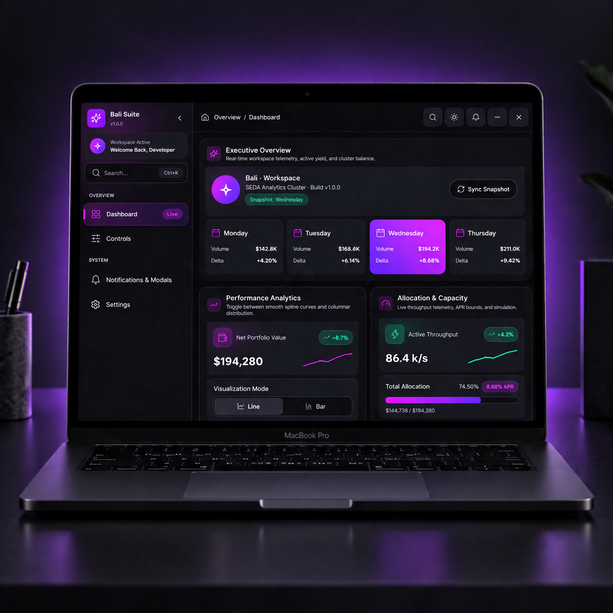
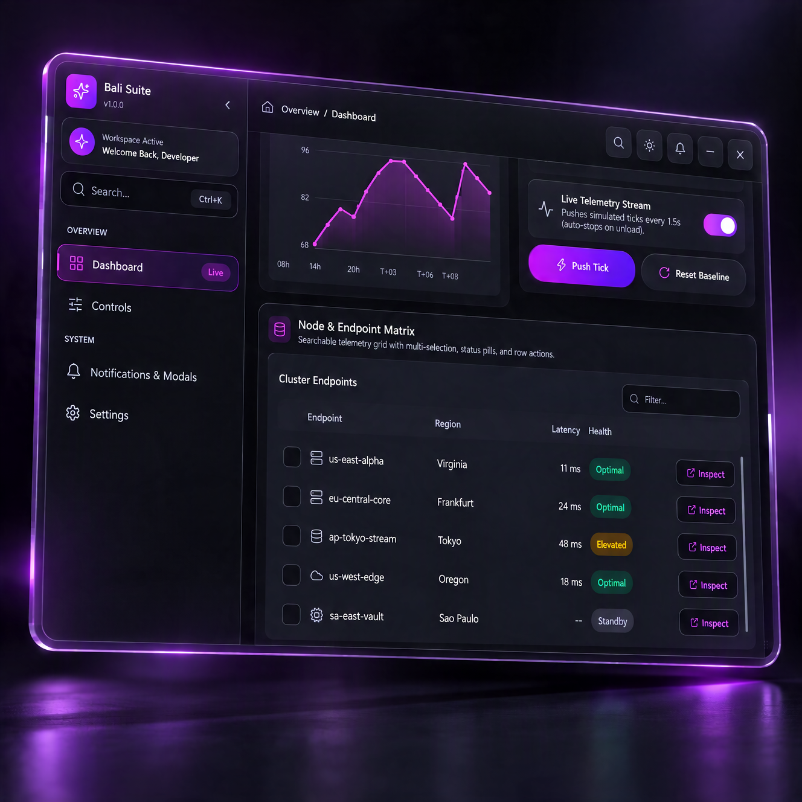
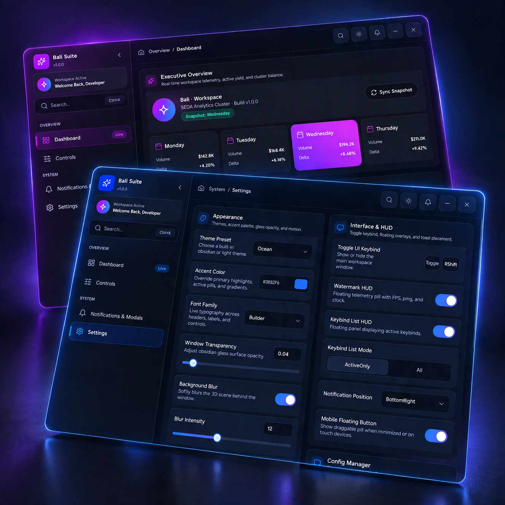

# Bali UI

**Obsidian glassmorphic UI library for Roblox and Luau** — built for buttery `Exponential` hardware motion, crisp `BuilderSans` typography, a bundled 164-icon Lucide sprite atlas, live re-theming, real-time analytics widgets, and standalone single-file bundles with zero runtime `loadstring` chains.

---

## Why Bali?

- **Zero-Stretch Motion Engine**: Every transition, hover state, tab switch, accordion expand, and popover uses smooth `Exponential Out` deceleration without `UIScale` distortion or `UIListLayout` neighbor jitter.
- **ZIndex-Isolated Layering**: Dedicated `Main`, `HUD`, `Popup`, `Dialog`, and `Notify` layers ensure dropdowns, HSV color pickers, modals, and toasts never clip or z-fight with scrolling containers.
- **164 Bundled Lucide Icons**: Self-contained `832x572` sprite sheet hydrated cleanly into executor asset APIs, with sharp monochrome glyph fallbacks inside sandboxed environments like Roblox Studio.
- **7 Built-in Themes & Live Customization**: Switch live between `Midnight`, `Ocean`, `Graphite`, `Aurora`, `Sunset`, `Emerald`, and `Light`, override accents dynamically, or register custom themes.
- **Full Control & Telemetry Suite**: Buttons (with `Confirm` guards), Toggles with inline keybinds, Checkboxes, Sliders, RangeSliders, Steppers, Masked/Numeric Inputs, Segmented controls, Searchable Single/Multi Dropdowns, HSV + Alpha + Rainbow ColorPicker, StatCards with Sparklines, live Line/Bar Charts, ProgressBars, searchable Tables, and CardGrids.

---

## Visual Tour

### Real-Time Telemetry & Endpoint Grids

### Live Multi-Theme Engine (`Midnight` & `Ocean`)

---

## Documentation Map

| Guide | Overview |
| :--- | :--- |
| [Getting Started](getting-started.md) | One-line executor quickstart, Roblox Studio setup & orphan cleanup |
| [Architecture & Motion](architecture.md) | Module layout, `ZIndex` layers, deceleration motion & Lucide atlas |
| [Window & Navigation](window-and-navigation.md) | `CreateWindow`, categories, tabs, sub-tabs, responsive columns & `Ctrl+K` palette |
| [Interactive Controls](interactive-controls.md) | Buttons, toggles, sliders, inputs, dropdowns, keybinds, color picker & accordions |
| [Analytics & Rich Content](analytics-and-data.md) | `StatCard`, `Chart`, `ProgressBar`, `Table`, `CardGrid` & static media cards |
| [HUD, Notifications & Modals](hud-and-systems.md) | Toast stack, unread bell history, watermark, keybind list, dialogs & blur |
| [Themes & Config Persistence](themes-and-config.md) | Preset palettes, custom themes, JSON flags & prebuilt `Settings` tab |
| [Loader & Key System](key-system-and-loader.md) | Glassmorphic splash loader and verified key gate |
| [Troubleshooting & Building](troubleshooting.md) | Re-bundling `dist/Bali.lua`, Luau compilation & Zune verification |
