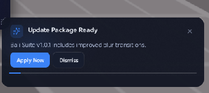
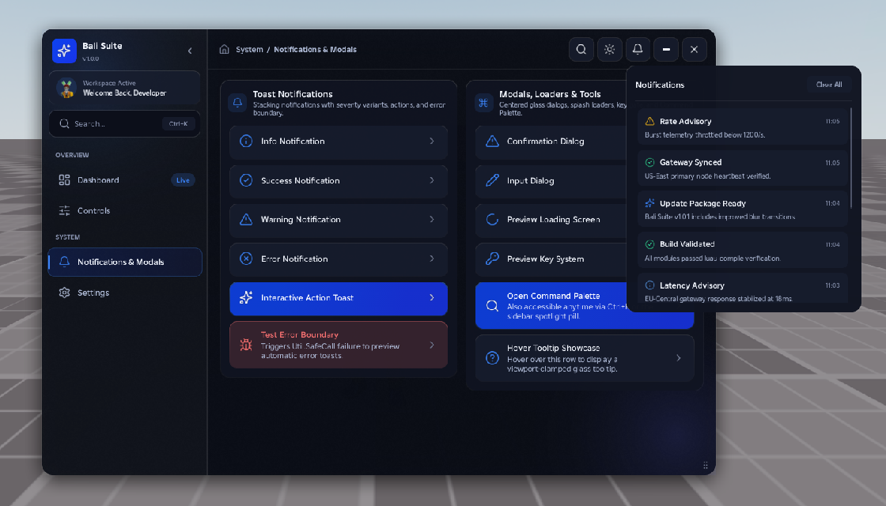

# HUD, Notifications & Modals

Bali separates system overlays into dedicated `ZIndex` layers (`HUD`, `Popup`, `Dialog`, `Notify`) so transient UI never gets clipped by inner scrolling containers.

---

## Notifications (`Toast` & Unread History)

Notifications render in `BaliNotifyLayer` without circular badges or outdated side bars, displaying a clean Lucide severity icon chip, dismiss control, hover-pausable linear timer pill, configurable default display window (`Bali:SetNotificationDuration(seconds)` / Settings slider `1s–15s`), and optional interactive action buttons.



```lua
-- Optional: override global default toast visibility window (1–30 seconds)
Bali:SetNotificationDuration(6)

local toast = Bali:Notify({
	Title = "Build Validated",
	Content = "All modules compiled without warnings.",
	Type = "Success", -- "Info" | "Success" | "Warning" | "Error" | "Accent"
	Duration = 4.5, -- omits to use Bali:GetNotificationDuration(); pass false to persist
	Actions = {
		{
			Text = "Dismiss",
			Variant = "Ghost",
			Callback = function(note)
				note:Dismiss()
			end,
		},
	},
})
```

### Notification Bell Popover

Every dispatched `window:Notify(...)` or `Bali:Notify(...)` is automatically indexed in the notification feed accessible from the top-right bell button in the window header, with severity Lucide icons, timestamps, and **Clear All**:



---

## Watermark (`Systems/Watermark`)

Drags smoothly across the screen while remaining cleanly offset below Roblox's top bar controls (`Y >= 58px`), displaying custom workspace title, FPS, server ping, player count, and clock time.

```lua
Bali.Watermark.SetTitle("Bali Suite | Workspace")
Bali.Watermark.SetVisible(true)
Bali.Watermark.SetStats({
	FPS = true,
	Ping = true,
	Time = true,
	Players = false,
})
```

---

## Keybind List (`Systems/KeybindList`)

Tracks registered keybinds live and filters between `"ActiveOnly"` and `"All"` modes. Clicking any `Keybind` control's bind automatically synchronizes here when `SyncList = true`.

```lua
Bali.KeybindList.SetVisible(true)
Bali.KeybindList.SetMode("ActiveOnly") -- "ActiveOnly" | "All"
```

---

## Modal Dialogs (`window:Dialog`)

Centered confirmation, alert, and text-prompt modals mounted inside `BaliDialogLayer` with optional blurred/dimmed click-outside dismiss (`Dismissible = true`):

```lua
window:Dialog({
	Title = "Reset Workspace?",
	Content = "This restores all flags back to their default state.",
	Icon = "triangle-alert",
	Input = {
		Placeholder = "Type CONFIRM to proceed...",
	},
	Buttons = {
		{ Text = "Cancel", Variant = "Default" },
		{
			Text = "Reset",
			Variant = "Danger",
			Callback = function(inputValue)
				print("Confirmed with input:", inputValue)
			end,
		},
	},
})
```

---

## Tooltips & Background Blur

- **Tooltips (`Systems/Tooltip`)**: Automatically clamp inside viewport edges. Attach `Tooltip = "Helpful explanation"` to any section control, or bind custom widgets via `Bali.Tooltip.Bind(guiObject, "Text")`.
- **Blur (`Systems/Blur`)**: Controls a singleton `Lighting.BlurEffect` synchronized with `window:IsVisible()`, adjustable dynamically via `Bali.Blur.SetEnabled(bool)` and `Bali.Blur.SetIntensity(px)`.
