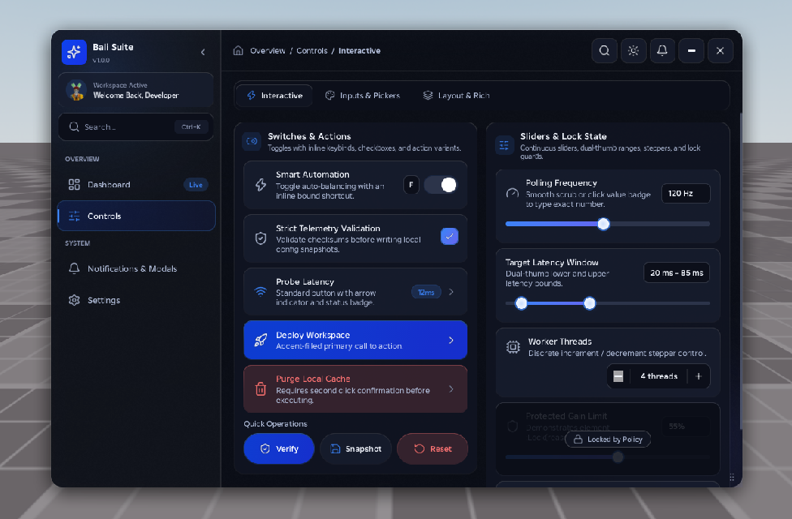
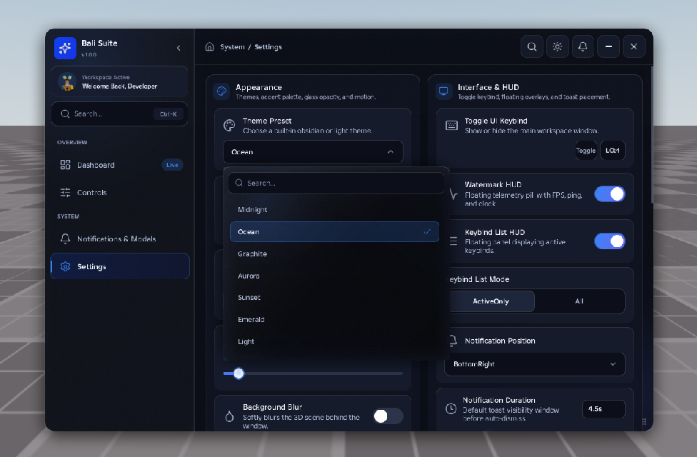
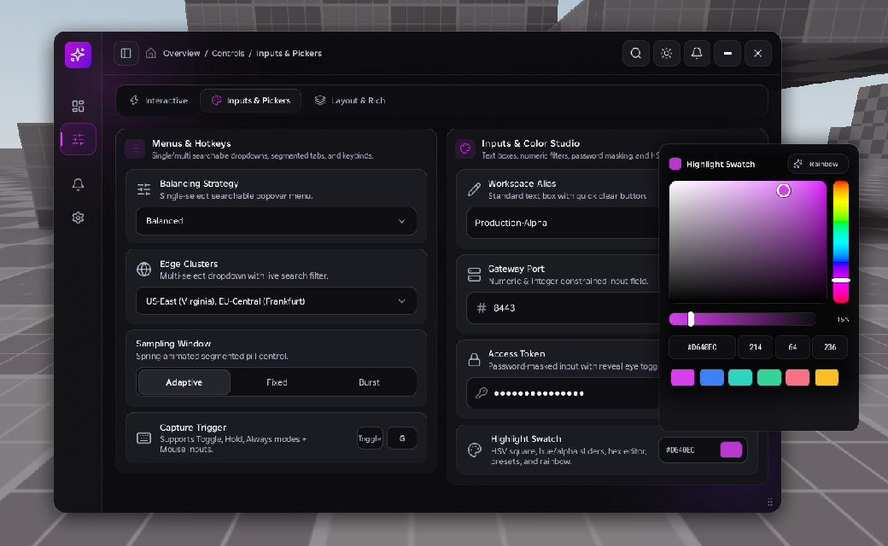

# Interactive Controls

Every control can be constructed on a `Section`, `Accordion`, `Tab`, or `SubTab`. All elements share unified base methods (`:SetTitle()`, `:SetDesc()`, `:SetVisible()`, `:SetDisabled()`, `:Lock()`, `:Unlock()`, `:Flash()`, `:OnChanged()`, `:Destroy()`) and expose flags via `window.Flags[flagName]`.



---

## `AddButton` & `AddButtonGroup`

Buttons support four surface variants (`"Default"`, `"Primary"`, `"Danger"`, `"Ghost"`), Lucide icons, badges, trailing chevrons (`ShowArrow`), and a two-step `Confirm` safety guard.

```lua
section:AddButton({
	Title = "Deploy Patch",
	Description = "Pushes staged config changes.",
	Icon = "rocket",
	Variant = "Primary",
	Confirm = "Click again to confirm",
	Callback = function()
		window:Notify({ Title = "Deployed", Content = "Patch applied cleanly.", Type = "Success" })
	end,
})

section:AddButtonGroup({
	Title = "Quick Actions",
	Buttons = {
		{ Title = "Restart", Icon = "rotate-cw", Variant = "Default", Callback = function() end },
		{ Title = "Purge", Icon = "trash-2", Variant = "Danger", Confirm = true, Callback = function() end },
	},
})
```

- **Methods**: `btn:SetText(str)`, `btn:SetVariant(variant)`, `btn:Fire()` (programmatic trigger), `group:GetButton(index)`.

---

## `AddToggle` & `AddCheckbox`

Smooth pill switches (`AddToggle`) and compact square checkboxes (`AddCheckbox`). `AddToggle` also supports an optional inline keybind badge right beside the switch.

```lua
local streamToggle = section:AddToggle({
	Title = "Live Telemetry Stream",
	Description = "Streams metrics every 1.5 seconds.",
	Default = true,
	Keybind = Enum.KeyCode.T,
	Flag = "TelemetryStream",
	Callback = function(enabled)
		print("State:", enabled)
	end,
})

section:AddCheckbox({
	Title = "Verify Checksums",
	Default = false,
	Flag = "VerifyChecksums",
	Callback = function(checked) end,
})
```

- **Methods**: `:Set(bool, silent?)`, `:Get()`, `:Toggle()`, `:Fire()`, and on `Toggle`: `:SetKeybind(keyCode)`, `:GetKeybind()`.

---

## `AddSlider`, `AddRangeSlider` & `AddStepper`

```lua
section:AddSlider({
	Title = "Max Frame Budget",
	Min = 4,
	Max = 60,
	Step = 0.5,
	Default = 16.5,
	Suffix = " ms",
	Flag = "FrameBudget",
	Callback = function(value) end,
})

section:AddRangeSlider({
	Title = "Dynamic Latency Bounds",
	Min = 0,
	Max = 250,
	Step = 5,
	MinGap = 15,
	Default = { 20, 95 },
	Suffix = " ms",
	Flag = "LatencyRange",
	Callback = function(low, high) end,
})

section:AddStepper({
	Title = "Worker Threads",
	Min = 1,
	Max = 16,
	Step = 1,
	Default = 4,
	Flag = "WorkerThreads",
	Callback = function(count) end,
})
```

- Hold `-` or `+` on `Stepper` for rapid repeat ticks.
- **Slider methods**: `:Set(val, silent?)`, `:Get()`, `:SetMin(val)`, `:SetMax(val)`.
- **RangeSlider methods**: `:Set(low, high, silent?)` or `:Set({ low, high }, silent?)`, `:Get()` -> `{ low, high }`.
- **Stepper methods**: `:Set(val, silent?)`, `:Get()`, `:Step(delta)`.

---

## `AddInput` / `AddTextBox`

Supports standard text, numeric/integer filtering (`Numeric = true`, `Integer = true`), masked secrets (`Mask = true` / `Password = true` with UTF-8 cursor reconciliation and reveal eye button), clear button (`Clearable = true`), character cap (`MaxLength`), and live typing (`Live = true` or `Finished = false`).

```lua
section:AddInput({
	Title = "Gateway Port",
	Placeholder = "8443",
	Default = "8443",
	Numeric = true,
	Integer = true,
	Icon = "hash",
	Flag = "GatewayPort",
	Callback = function(text, enterPressed) end,
})

section:AddInput({
	Title = "Access Token",
	Password = true,
	Clearable = true,
	Icon = "key",
	Flag = "AccessToken",
})
```

- **Methods**: `:Set(text, silent?)`, `:Get()`, `:Focus()`.

---

## `AddSegmented`

Animated segmented pill selector ideal for switching visualization modes, presets, or quality profiles.

```lua
section:AddSegmented({
	Title = "Sampling Window",
	Values = { "Adaptive", "Fixed", "Burst" },
	Default = "Adaptive",
	Accent = false,
	Flag = "SamplingMode",
	Callback = function(value, index) end,
})
```

- **Methods**: `:Set(valueOrIndex, silent?)`, `:Get()`, `:SetValues(list, default?)`.

---

## `AddDropdown`



Viewport-aware popover dropdown mounted in `BaliPopupLayer` with compact `28px` single-line option rows, active modal input blocking so sliders underneath cannot react while browsing options, live search filtering, single or multi selection, and dynamic option updates.

```lua
local clusters = section:AddDropdown({
	Title = "Edge Clusters",
	Description = "Multi-select dropdown with live search filter.",
	Values = {
		"US-East (Virginia)",
		"US-West (Oregon)",
		"EU-Central (Frankfurt)",
		"EU-West (London)",
		"AP-Northeast (Tokyo)",
		"AP-Southeast (Singapore)",
	},
	Default = { "US-East (Virginia)", "EU-Central (Frankfurt)" },
	Multi = true,
	Searchable = true,
	AllowNull = false,
	MaxVisible = 6,
	Flag = "EdgeClusters",
	Callback = function(selectedList) end,
})
```

- **Methods**: `:Open()`, `:Close()`, `:Set(valueOrTable, silent?)`, `:Get()`, `:SetValues(list)`.

---

## `AddKeybind`

Dedicated key & mouse binder supporting `Toggle`, `Hold`, and `Always` modes, automatic sync to `KeybindList`, and right-click context menu for changing mode inline.

```lua
section:AddKeybind({
	Title = "Capture Trigger",
	Default = Enum.KeyCode.G,
	Mode = "Toggle", -- "Toggle" | "Hold" | "Always"
	AllowMouse = true,
	SyncList = true,
	Flag = "CaptureTrigger",
	Callback = function(isActive) end,
	ChangedCallback = function(newKey, newMode) end,
})
```

- **Methods**: `:Set(key, mode?, silent?)`, `:Get()` -> `key, mode`, `:GetState()`.

---

## `AddColorPicker`

Interactive HSV square + hue slider + alpha channel slider (`Transparency`) + live Hex/RGB editors + solid color preset chips + animated `Rainbow` toggle.



```lua
section:AddColorPicker({
	Title = "Highlight Swatch",
	Default = Color3.fromRGB(214, 64, 236),
	Transparency = 0.15, -- 0 = opaque, 1 = transparent
	Rainbow = false,
	Flag = "HighlightSwatch",
	Callback = function(color, transparency) end,
})
```

- **Methods**: `:Open()`, `:Close()`, `:Set(color, transparency?, silent?)`, `:Get()` -> `color, transparency`, `:SetRainbow(bool)`.

---

## `AddAccordion`

Collapsible container supporting nested child controls via `Container.Attach`:

```lua
local acc = section:AddAccordion({
	Title = "Diagnostic Buffer Settings",
	Description = "Expandable container hosting nested controls.",
	Icon = "sliders-horizontal",
	Default = false,
	Flag = "DiagnosticAccordion",
})

acc:AddToggle({ Title = "Frame Time Capture", Default = false })
acc:AddStepper({ Title = "Ring Buffer Capacity", Min = 64, Max = 1024, Step = 64, Suffix = " KB" })
```

- **Methods**: `:Expand(silent?)`, `:Collapse(silent?)`, `:Toggle(silent?)`, `:SetExpanded(bool, silent?)`, `:IsExpanded()`, `:Get()`.
