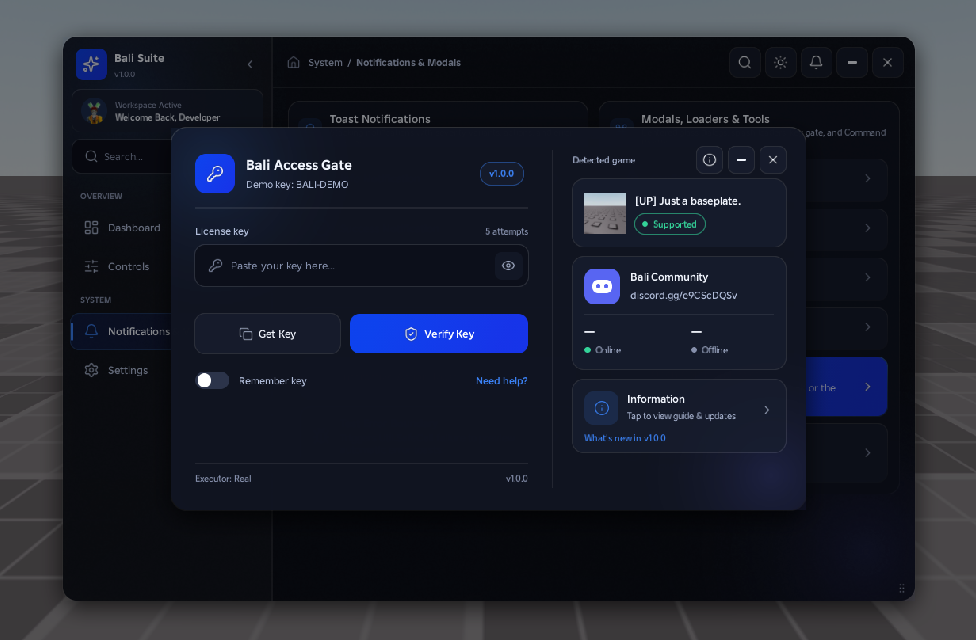

# Loader & Key System

Display a branded glassmorphic splash loader (`Bali:LoadingScreen`) or credential verification gate (`Bali:KeySystem`) before constructing the main workspace window.



---

## `Bali:LoadingScreen(opts)`

Mounts a centered obsidian splash modal with icon bloom, animated progress track, and step status messages:

```lua
Bali:LoadingScreen({
	Title = "Bali Suite",
	Subtitle = "Initializing runtime modules...",
	Icon = "sparkles",
	Duration = 1.6,
	Steps = {
		"Hydrating Lucide asset atlas...",
		"Calibrating obsidian shaders...",
		"Preparing workspace layout...",
	},
	AutoClose = true,
	Backdrop = true,
	Yield = true, -- pauses caller until steps finish
	OnComplete = function()
		print("Loader finished!")
	end,
})
```

If `Yield = false`, the returned controller exposes `:SetStatus(text)`, `:SetProgress(alpha, statusText?)`, `:Close(onDone?)`, `:Wait()`, and `:Destroy()`.

---

## `Bali:KeySystem(opts)`

Mounts a two-column obsidian glass key gate featuring key masking, remember-key persistence, cooldown protection, live Detected Game `Supported` / `Not Supported` status badges, Discord community counts, and a slide-in Information & Changelog drawer:

```lua
local unlocked = false

Bali:KeySystem({
	Title = "Bali Access Gate",
	Subtitle = "Key System",
	Version = "v2.0",
	Icon = "key",
	Keys = { "BALI-DEMO" }, -- or custom Verify = function(candidate) return true, "Reason" end
	KeyUrl = "https://example.com/get-key", -- copied on clicking "Get Key"
	SupportedGames = {
		[2753915549] = "Blox Fruits",
	},
	DiscordName = "Bali Community",
	DiscordInvite = "your-invite-code", -- optional invite URL or code for live member counts
	DiscordGuildId = "", -- optional widget.json fallback ID
	Changelog = {
		{ Version = "v2.0", Date = "Today", Changes = { "Initial release" } },
	},
	MaxAttempts = 5,
	Cooldown = 8,
	SaveKey = true,
	Folder = "Bali",
	FileName = "license.key",
	Closable = true,
	Minimizable = true,
	Yield = true,
	OnSuccess = function(key)
		unlocked = true
		print("Authenticated with:", key)
	end,
	OnCancel = function()
		warn("Verification cancelled")
	end,
})

if not unlocked then
	return
end
```

### Verification Option Priority

1. `Verify(candidate)` / `CheckKey(candidate)` / `Callback(candidate)` — custom validator returning `boolean, optionalErrorMessage`.
2. `Keys` (array of accepted keys) or `Key` (single accepted string).
3. If `SaveKey = true` and a saved key passes verification on startup, `KeySystem` immediately fires `OnSuccess` without blocking the user again.
4. When `SupportedGames` is provided, matching `game.PlaceId` / `game.GameId` entries display a green `Supported` badge and unmatched games display a red `Not Supported` badge.
