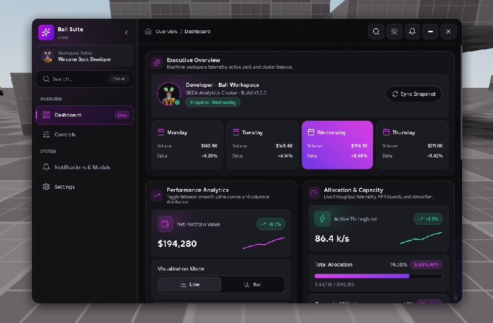
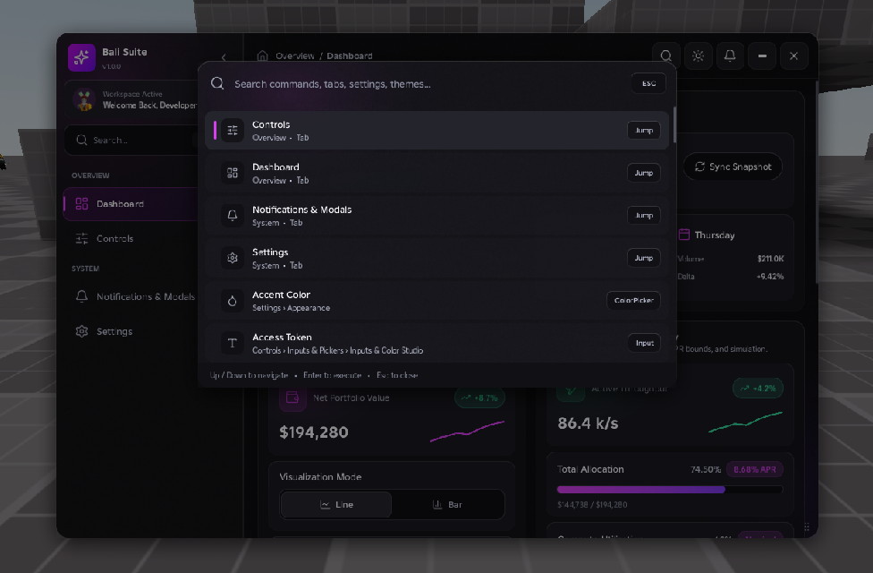

# Window & Navigation

A Bali interface is structured hierarchically: **`Window`** -> **Sidebar `Category` & `Tab`** -> optional **`SubTab`** -> **`Section`** (`Left`, `Right`, `Auto`, or `Full` band) -> **Elements**.



---

## `Bali:CreateWindow(opts)`

Creates the main draggable and resizable obsidian window.

```lua
local window = Bali:CreateWindow({
	Title = "Bali Suite",
	Subtitle = "v1.0.0",
	Icon = "sparkles",
	ShowUser = true,
	WelcomeSubtitle = "Workspace Active",
	Size = UDim2.fromOffset(820, 540),
	MinSize = Vector2.new(460, 360),
	MaxSize = Vector2.new(1280, 900),
	SidebarWidth = 216,
	SidebarCollapsed = false,
	Theme = "Midnight",
	Accent = nil,
	Font = "Builder",
	ToggleKey = Enum.KeyCode.RightShift,
	Blur = true,
	BlurIntensity = 12,
	Watermark = true,
	KeybindList = true,
	NotificationPosition = "BottomRight",
	MobileButton = true,
	ConfigFolder = "BaliSuite",
	AutoLoadConfig = true,
	ConfirmClose = true,
	DestroyOnClose = false,
	OnClose = function() end,
	OnDestroy = function() end,
})
```

### Window Methods

| Method | Description |
| :--- | :--- |
| `window:AddCategory(name)` | Creates or references a sidebar group label. |
| `window:AddTab(opts)` | Adds a `Tab` (`{ Title, Icon?, Category?, Badge? }`). |
| `window:SelectTab(tabOrTitleOrIndex, instant?)` | Switches active tab and updates the top breadcrumb. |
| `window:ToggleSidebar(collapsed?)` | Collapses sidebar into compact icon rail or expands it. |
| `window:SetVisible(visible)` | Shows or hides the window cleanly while syncing Blur and `MobileButton`. |
| `window:Toggle()` / `window:IsVisible()` | Toggles visibility or queries current open state. |
| `window:SetToggleKey(keyCode)` / `window:GetToggleKey()` | Updates or reads the global visibility hotkey (`RightShift` default). |
| `window:SetTitle(text)` / `window:SetSubtitle(text)` | Updates sidebar workspace header text live. |
| `window:SetMobileButtonEnabled(enabled)` | Shows or hides the draggable floating reopen pill on minimize / touch. |
| `window:BuildSettingsTab(opts?)` | Auto-generates the full **Settings** tab (themes, HUD, config, diagnostics). |
| `window:Dialog(opts)` | Displays a centered modal confirmation or prompt dialog. |
| `window:Notify(opts)` | Dispatches a toast notification linked to this window's bell history. |
| `window:Destroy()` | Tears down the window, its popups, and owned cleanup tasks. |

---

## Tabs & Categories

Sidebar navigation automatically scrolls as tabs grow and displays live active indicator bars and badges:

```lua
window:AddCategory("Overview")

local dashboard = window:AddTab({
	Title = "Dashboard",
	Icon = "layout-dashboard",
	Badge = "Live",
})

dashboard:SetBadge("Synced") -- dynamically update badge text or pass "" / nil to hide
```

---

## Sub-Tabs (`tab:AddSubTab`)

For feature-rich modules, subdivide any tab with an inset horizontal segmented sub-tab bar:

```lua
local controls = window:AddTab({
	Title = "Controls",
	Icon = "sliders-horizontal",
	Category = "Overview",
})

local interactiveSub = controls:AddSubTab({ Title = "Interactive", Icon = "zap" })
local pickersSub = controls:AddSubTab({ Title = "Inputs & Pickers", Icon = "palette" })
```

Switching sub-tabs smoothly glides the inset pill and cross-slides the sub-tab canvas inside a `ClipsDescendants`-guarded viewport without border clipping.

---

## Sections & Responsive Columns

Both `Tab` and `SubTab` organize cards cleanly into dual-column or full-width bands:

```lua
local leftSec = interactiveSub:AddSection({
	Title = "Actions & Toggles",
	Subtitle = "Animated controls with optional confirm & keybinds.",
	Icon = "zap",
	Side = "Left", -- "Auto" | "Left" | "Right" | "Full"
	Collapsible = true,
	DefaultOpen = true,
})
```

- `"Auto"` balances sections alternately between `Left` and `Right` columns.
- `"Full"` spans `100%` of the content width for wide widgets like `Table`, `CardGrid`, or full-width banners.
- Narrow viewports (`< 560px` canvas width) automatically stack dual columns vertically so controls stay touch-friendly and readable on mobile screens.

---

## Command Palette (`Ctrl+K`)

Press `Ctrl+K` (or click the top search pill / header magnifying glass) to search every registered tab, sub-tab, section, element, flag, or action. The modal opens dynamically centered over the active window frame (clamped within the viewport) and isolates pointer input behind it. Executing a result jumps directly to the matching tab/sub-tab, opens collapsed parent sections or accordions, scrolls the element into view, and flashes its surface border.


